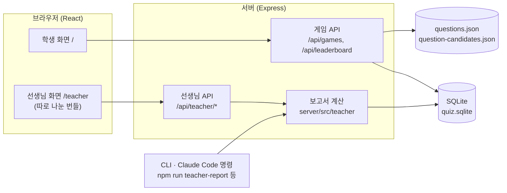
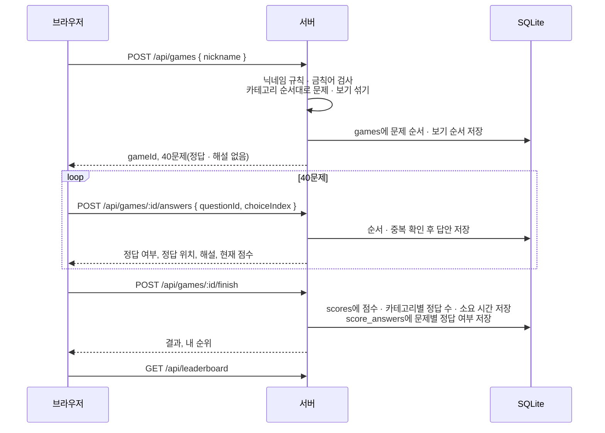

# 상식 퀴즈 게임

한국사 · 과학 · 지리 · 예술과 문화 4개 카테고리 40문제를 풀고, 서버가 채점해 순위표에 올리는 웹 퀴즈 게임입니다.
교실에서 쓰도록 만들었고, 선생님은 같은 웹에서 학생 명단을 관리하고 반 성적 · 학생 비교 · 약점 · 성적 추이를 볼 수 있습니다.

- 학생: 닉네임만 넣고 바로 시작합니다. 로그인도, 개인정보 수집도 없습니다
- 정답과 해설은 답을 고른 뒤에만 서버가 알려 줍니다. 브라우저 코드와 네트워크 응답에서 미리 볼 수 없습니다
- 선생님: `/teacher` 주소에서 공용 비밀번호로 로그인합니다

## 목차

- [주요 기능](#주요-기능)
- [작동 방식](#작동-방식)
- [선생님 모드](#선생님-모드)
- [시작하기](#시작하기)
- [환경 변수](#환경-변수)
- [명령어](#명령어)
- [폴더 구조](#폴더-구조)
- [데이터와 보관 기간](#데이터와-보관-기간)
- [문제 관리](#문제-관리)
- [테스트와 품질 기준](#테스트와-품질-기준)
- [문서](#문서)

## 주요 기능

### 학생 화면

| 화면 | 내용 |
| --- | --- |
| 시작 | 규칙 요약(4개 카테고리 · 40문제 · 400점 만점), 닉네임 입력(2~10자, 한글·영문·숫자), 순위표 보기 |
| 카테고리 전환 | 카테고리가 바뀔 때 1초 동안 "과학 — 10문제"처럼 안내 |
| 문제 | 진행률 바, 카테고리, 문제 번호(13/40), 현재 점수, 보기 4개 |
| 피드백 | 답을 고르면 0.3초 안에 정답(초록 ✓) · 오답(빨강 ✗)과 해설 표시. 고른 답은 바꿀 수 없음. 효과음(켜고 끄기 가능) |
| 결과 | 총점, 정답 수, 카테고리별 막대 그래프, 소요 시간, 오답 노트(내 답 · 정답 · 해설), 내 순위(10위 밖이어도 표시), 상위 10명 순위표 |

- 게임 중 뒤로 가기 · 창 닫기 · 처음으로를 누르면 확인 창이 뜹니다
- 키보드만으로 끝까지 풀 수 있습니다: `1`~`4`로 보기 선택, `Enter`로 다음 문제
- 스크린 리더가 보기 번호와 내용, 정답·오답 결과를 읽어 줍니다
- 휴대폰(360px)부터 PC까지 같은 화면을 씁니다
- 네트워크가 끊겨 답 전송이나 저장에 실패하면 오류 문구와 다시 시도 버튼이 나옵니다

### 선생님 화면 (`/teacher`)

| 메뉴 | 내용 |
| --- | --- |
| 성적표 | 반 요약(평균 · 표준편차 · 등급 분포 · 점수 구간), 학생별 등급 · 순위 · 최고/평균/최근 점수 · 카테고리 정답률 · 빠른 기록, 열 정렬 |
| 학생 비교 | 학생 2명 이상을 골라 나란히 비교. 항목별 가장 좋은 값 표시, 반 평균 대비, 20%p 이상 차이, 서로 가르쳐 줄 짝 |
| 약점 | 카테고리별 정답률과 50% 미만 학생, 많이 틀린 문제와 틀린 학생, "다시 가르칠 내용" 후보 |
| 추이 | 학생별 첫 점수 → 최근 점수(📈 향상 · 📉 하락 · ➡️ 유지), 날짜별 반 평균, 학생 한 명의 회차별 기록 |
| 학생 명단 | 반 이름, 학생(출석 번호 · 이름) 추가 · 삭제, 학생별 닉네임 연결, 명단에 없는 닉네임을 골라 학생에게 연결 |
| 기록 관리 | 닉네임 · 학생 이름 · 빠른 기록으로 기록 찾기, 확인 후 삭제 |
| 문제 교체 | 출제 문제와 같은 카테고리 · 난이도의 후보 문제를 바꿈. 서버를 다시 시작하지 않아도 새 게임에 바로 반영 |

성적 화면 4개는 기간(전체 · 오늘 · 최근 7일 · 최근 30일 · 날짜 지정)을 함께 씁니다.

## 작동 방식

### 전체 구조



- 클라이언트는 React + TypeScript + Vite, 서버는 Express + better-sqlite3입니다
- 문제 데이터(`server/data/questions.json`)는 서버에만 있습니다. 클라이언트 코드는 이 파일을 import하지 않고, 빌드할 때 `scripts/check-bundle.mjs`가 번들에 문제나 해설이 섞이지 않았는지 검사합니다
- 서버 코드는 빌드 단계 없이 Node가 TypeScript를 직접 실행합니다(type stripping, Node 22.18 이상)

### 한 판의 흐름



1. **시작**: 서버가 한국사 → 과학 → 지리 → 예술과 문화 순서로, 카테고리 안의 문제 순서와 보기 순서를 무작위로 섞습니다. 브라우저에는 문제와 섞인 보기만 보냅니다
2. **답하기**: 지금 차례인 문제에만, 한 번만 답할 수 있습니다. 다른 답을 다시 보내면 409로 거부합니다. 같은 답을 다시 보내면(응답을 잃어버린 경우) 처음과 같은 결과를 돌려줍니다
3. **끝내기**: 40문제를 모두 답해야 저장됩니다. 점수와 시간은 서버 기록으로만 계산하고, 브라우저가 보낸 값은 무시합니다. 다시 요청해도 한 번만 저장됩니다
4. **중간에 나간 게임**은 순위표에 들어가지 않고, 시작 후 24시간이 지나면 지워집니다

### 채점 규칙

| 항목 | 규칙 |
| --- | --- |
| 점수 | 정답 1개당 10점, 오답 감점 없음, 400점 만점 |
| 소요 시간 | 첫 문제 표시부터 마지막 답까지. 카테고리 전환 화면 1초씩은 뺍니다 |
| 순위 | 점수 높은 순, 같으면 빨리 푼 순. 점수와 시간이 모두 같으면 같은 순위 |
| 기록 | 같은 닉네임이 여러 번 풀면 모두 따로 저장됩니다 |

### 문제 교체가 진행 중인 게임에 주는 영향

새 게임은 **출제 문제**에서만 뽑고, 저장된 게임은 **출제 문제 + 후보 문제** 전체에서 id로 찾습니다.
그래서 선생님이 문제를 바꾸기 전에 시작한 게임은 원래 문제로 끝까지 풀 수 있습니다(서버를 다시 시작해도 마찬가지). 문제 id는 다시 쓰지 않습니다.

## 선생님 모드

### 로그인과 보안

- 공용 비밀번호 하나(`TEACHER_PASSWORD`, 8자 이상)로 로그인합니다. 설정하지 않으면 `/api/teacher/*`가 모두 404이고 선생님 모드가 꺼집니다
- 세션은 httpOnly · SameSite=Strict 쿠키이고, DB에는 토큰의 해시만 저장합니다. 마지막 요청 후 30분이 지나면 만료됩니다
- 같은 접속 IP에서 2분 안에 비밀번호를 5번 틀리면 잠시 로그인을 막습니다(429)
- 선생님 화면은 학생 화면과 따로 나눈 파일로 불러오므로, 학생 번들에는 선생님 코드가 들어가지 않습니다

### 학생 명단

게임은 닉네임만 받으므로, 한 학생이 여러 닉네임을 쓰면 다른 사람처럼 보입니다. 명단에서 학생마다 닉네임을 묶어 줍니다.

- 한 닉네임은 한 학생에게만 연결됩니다. 닉네임은 정확히 같을 때만 같은 사람으로 봅니다
- 명단에 없는 닉네임의 기록은 "미등록"으로 따로 보여 주고 학생 통계에는 넣지 않습니다. "지훈2 → 박지훈"처럼 비슷한 학생은 힌트로만 보여 주고 자동으로 묶지 않습니다
- 학생을 명단에서 빼도 순위표 기록은 남습니다

### 보고서 계산

웹 성적 화면(`GET /api/teacher/report`)과 CLI(`npm run teacher-report`), Claude Code의 `/teacher-*` 명령이 모두 `server/src/teacher/report.ts`의 같은 계산을 씁니다. 규칙의 원문은 [docs/teacher-mode.md](docs/teacher-mode.md)입니다.

| 항목 | 규칙 |
| --- | --- |
| 학생 대표 값 | 최고 점수, 평균 점수(기간 안 모든 기록), 최근 점수, 카테고리별 정답률 |
| 반 평균 · 표준편차 | 응시한 학생들의 평균 점수로 계산(모집단 표준편차) |
| 등급(상대평가) | 평균 점수 순위의 상위 20% A, 40% B, 70% C, 나머지 D. 동점은 같은 순위 · 같은 등급. 응시 5명 미만이면 매기지 않음 |
| ⚠️ / ⭐ | 반 평균보다 한 표준편차 이상 낮음 / 높음. 응시 3명 미만이면 표시하지 않음 |
| ⏱️ 빠른 기록 | 80초 미만(문제당 2초 미만). 계산에서 빼지 않고 표시만 하며, 절반 이상이면 주의 문장을 띄움 |
| 추세 | 첫 점수와 최근 점수의 차이가 +30 이상 📈, −30 이하 📉, 그 사이 ➡️ |
| 많이 틀린 문제 | 학생마다 기간 안 가장 최근 게임 하나만 셈. 3명 이상이 푼 문제만 오답률 계산. 쉬운 문제인데 오답률이 50%를 넘으면 "다시 가르칠 내용" |
| 기간 | 로컬 날짜 기준. `7d`는 오늘을 포함한 최근 7일 |

## 시작하기

### 필요한 것

- Node.js 22.18 이상 (서버가 TypeScript를 직접 실행합니다)
- npm

### 설치와 개발 서버

```sh
npm install
npm run dev
```

- 게임: http://localhost:5173
- 선생님 화면: http://localhost:5173/teacher (`TEACHER_PASSWORD`를 설정해야 켜집니다)
- `npm run dev`는 Vite(5173)와 API 서버(3001)를 함께 실행하고, Vite가 `/api` 요청을 API 서버로 넘깁니다

선생님 모드를 켜고 실행하려면:

```sh
# macOS · Linux · Git Bash
TEACHER_PASSWORD=원하는비밀번호 npm run dev

# PowerShell
$env:TEACHER_PASSWORD = '원하는비밀번호'; npm run dev
```

### 테스트 데이터로 선생님 화면 보기

실제 DB를 건드리지 않고 가상의 반(8명, 기록 15건)으로 선생님 화면을 볼 수 있습니다.

```sh
npm run teacher-fixture -- tmp/fx.sqlite
DB_PATH=tmp/fx.sqlite TEACHER_PASSWORD=teacher-test-1234 npm run dev
```

`tmp/`는 gitignore 대상입니다. 기록 시각은 만든 시점 기준이라, 하루가 지나면 "오늘" 기록이 비어 보입니다. 다시 만들면 됩니다.

### 운영 배포

```sh
npm run build   # 타입 검사 → Vite 빌드 → 번들에 문제 데이터가 없는지 검사
npm start       # 빌드된 dist/와 API를 한 서버(기본 3001)로 제공
```

HTTPS 뒤에서 운영할 때는 `NODE_ENV=production`(선생님 쿠키에 Secure 추가)을, 리버스 프록시 뒤라면 `TRUST_PROXY`도 설정합니다.

## 환경 변수

| 이름 | 기본값 | 설명 |
| --- | --- | --- |
| `PORT` | `3001` | API 서버 포트 |
| `DB_PATH` | `server/data/quiz.sqlite` | SQLite 파일 경로 (없으면 만듦) |
| `BANNED_WORDS_PATH` | `server/data/banned-words.txt` | 닉네임 금칙어 목록 |
| `TEACHER_PASSWORD` | 없음 | 선생님 공용 비밀번호(8자 이상). 없으면 선생님 모드 꺼짐 |
| `NODE_ENV` | 없음 | `production`이면 선생님 세션 쿠키에 Secure를 붙임(HTTPS 필요) |
| `TRUST_PROXY` | 없음 | 리버스 프록시 뒤에서 실제 접속 IP로 로그인 실패를 세도록 Express `trust proxy` 값(`true`, 홉 수 등) |

## 명령어

### npm 스크립트

| 명령 | 하는 일 |
| --- | --- |
| `npm run dev` | 개발 서버(Vite + API) |
| `npm test` | Vitest 전체(클라이언트 · 서버 · shared) |
| `npm run build` | 타입 검사, 빌드, 번들 검사 |
| `npm start` | 빌드 결과와 API를 한 서버로 제공 |
| `npm run lint` | oxlint |
| `npm run review-doc` | 문제 파일에서 `docs/questions-review.md` 검수표를 다시 만듦 |
| `npm run swap-question -- <출제 id> <후보 id>` | 같은 카테고리 · 난이도의 출제 문제와 후보 문제를 바꿈(서버 재시작 후 반영) |
| `npm run delete-score -- <기록 id>` | 기록 하나와 그 문제별 답안 삭제 |
| `npm run roster -- <작업>` | 학생 명단 관리(`list`, `class`, `add`, `link`, `unlink`, `remove`, `unmatched`) |
| `npm run import-roster -- <파일> [--replace]` | 예전 `teacher/roster.json` 형식의 명단을 DB로 가져오기 |
| `npm run teacher-report -- [기간] [--json] [--compare 1,3,5\|all]` | 선생님 보고서(웹 성적 화면과 같은 값). DB를 읽기 전용으로 엶 |
| `npm run teacher-fixture -- <새 DB 경로>` | 선생님 모드 테스트용 DB와 명단 만들기(실제 DB 경로는 거부) |

### Claude Code 명령

이 저장소는 [Claude Code](https://claude.com/claude-code)로 만들었고, 운영을 돕는 명령이 `.claude/commands/`에 있습니다.

| 명령 | 하는 일 |
| --- | --- |
| `/quiz-add`, `/quiz-swap` | 후보 문제 추가, 출제 문제와 교체 |
| `/quiz-validate`, `/quiz-range`, `/quiz-check`, `/quiz-daily` | 최상급 표현 점검, 난이도 · 정답 분포 검토, 정답 사실 확인, 하루 점검 |
| `/quiz-stats`, `/quiz-leaderboard` | 게임 통계, 순위표 조회 · 점검 · 삭제 |
| `/teacher-roster`, `/teacher-scores`, `/teacher-compare`, `/teacher-weakness`, `/teacher-progress` | 선생님 모드의 명단과 각 분석 |
| `/teacher-mode [기간] [save] [csv\|pdf\|both]` | 위 분석을 모아 반 성적 보고서를 만들고, 원하면 CSV · PDF로 내보내기 |
| `/export-report` | 저장한 보고서를 CSV(Excel용) · PDF로 내보내기 |

`/teacher-*` 명령은 값을 직접 계산하지 않고 `npm run teacher-report -- <기간> --json` 결과를 씁니다. 그래서 보고서와 웹 성적표의 값이 같습니다.

## 폴더 구조

```text
├── server/                 Express API (Node가 TypeScript를 직접 실행)
│   ├── data/               questions.json(출제 40문제), question-candidates.json(후보), banned-words.txt
│   ├── src/
│   │   ├── game/           순수 게임 로직(섞기, 판정, 점수, 시간)과 문제 검증
│   │   ├── teacher/        선생님 보고서 계산(report.ts), DB 읽기, 기간, 테스트 데이터
│   │   ├── scripts/        npm 스크립트로 실행하는 CLI
│   │   ├── app.ts          라우트 구성
│   │   ├── db.ts           SQLite 스키마
│   │   ├── teacherAuth.ts  선생님 로그인 · 세션
│   │   └── teacher*.ts     선생님 API(명단, 문제 교체, 보고서, 기록 관리)
│   └── test/               Supertest API 테스트
├── shared/                 클라이언트와 서버가 함께 쓰는 API 타입, 닉네임 규칙
├── src/                    React 클라이언트
│   ├── api/client.ts       서버 통신은 여기로만
│   ├── game/reducer.ts     학생 화면 상태
│   ├── components/         학생 화면 컴포넌트, 접근성 검사(a11y.test.tsx)
│   ├── teacher/            /teacher 선생님 화면(따로 나눈 번들)
│   └── test/testServer.ts  클라이언트 테스트용: 실제 Express 앱과 메모리 DB로 fetch 처리
├── scripts/                번들 검사, 검수표 생성, 효과음 생성
├── docs/                   PRD, 문제 작성 기준, 문제 검수표, 선생님 모드 규칙
└── .claude/commands/       Claude Code 운영 명령
```

## 데이터와 보관 기간

수집하는 정보는 닉네임과 게임 결과뿐입니다. 학생 이름은 선생님이 명단에 넣을 때만 DB에 들어갑니다.

| 테이블 | 내용 | 보관 기간 |
| --- | --- | --- |
| `scores` | 닉네임, 점수, 카테고리별 정답 수, 소요 시간, 플레이 시각 | 계속(삭제하기 전까지) |
| `score_answers` | 기록마다 문제별 정답 여부(문제 id, 출제 순서, 맞았는지) | 그 기록과 같이. 기록을 지우면 함께 지워짐 |
| `games` | 진행 중인 게임의 문제 · 보기 순서와 답안 | 시작 후 24시간 |
| `teacher_sessions` | 선생님 세션 토큰의 해시 | 마지막 요청 후 30분 |
| `teacher_settings`, `students`, `student_nicknames` | 반 이름, 학생(출석 번호 · 이름), 학생별 닉네임 | 선생님이 지우기 전까지 |

- DB 파일(`server/data/quiz.sqlite*`)과 선생님 보고서 폴더(`teacher/`)는 학생 이름이 들어 있을 수 있어 gitignore 대상입니다
- 기록 삭제는 선생님 화면의 "기록 관리"나 `npm run delete-score`로 합니다

## 문제 관리

출제 문제는 카테고리마다 10문제(쉬움 4 · 보통 4 · 어려움 2)로 고정이고, 형식은 문제 80자 · 보기 30자 · 해설 120자 이내입니다. 서버는 시작할 때 이 규칙을 검사합니다.

1. 새 문제는 [docs/question-guidelines.md](docs/question-guidelines.md)의 교차 검증 기준(정답이 하나인지, 최상급 표현의 기준, 시점 · 범위, 출처 2개 이상)을 따릅니다
2. `questions.json`에 바로 넣지 않고 후보 파일(`question-candidates.json`)에 추가합니다
3. 선생님 화면의 "문제 교체"(바로 반영)나 `npm run swap-question`(서버 재시작 후 반영)으로 같은 칸의 출제 문제와 바꿉니다
4. `npm test`로 검증한 뒤 `npm run review-doc`으로 [docs/questions-review.md](docs/questions-review.md) 검수표를 다시 만듭니다

## 테스트와 품질 기준

```sh
npm test        # 단위 · API · 화면 테스트
npm run lint
npm run build   # 번들 검사 포함
```

- **게임 로직**: 섞은 뒤에도 정답 판정이 맞는지, 점수, 카테고리 순서, 소요 시간
- **API**: 정상 플레이 저장, 동점 정렬, 중복 답안 409, 40문제 미만 저장 거부, 닉네임 검사, 선생님 인증(404 · 401 · 429 · 세션 만료), 명단 검증, 보고서 값, 기록 삭제
- **보고서 계산**: 테스트 데이터의 예상값(반 평균 266.4, 표준편차 88.0 등), 빈 기간, 응시 1 · 2 · 4 · 5명일 때의 표시 규칙, 동점, 학생 단위 집계
- **화면**: 실제 Express 앱과 메모리 DB로 학생 · 선생님 화면을 끝까지 조작하고, 모든 화면에서 axe 접근성 검사(심각한 오류 0건)
- **정답 비노출**: 빌드 결과물에 문제 · 해설 문자열이 하나라도 있으면 빌드 실패

## 문서

| 문서 | 내용 |
| --- | --- |
| [docs/PRD.md](docs/PRD.md) | 요구 사항과 단계별 구현 범위(1~5단계) |
| [docs/teacher-mode.md](docs/teacher-mode.md) | 선생님 모드 계산 규칙의 원문 |
| [docs/question-guidelines.md](docs/question-guidelines.md) | 문제 작성 · 교차 검증 기준 |
| [docs/questions-review.md](docs/questions-review.md) | 출제 · 후보 문제 검수표(자동 생성) |
| [CLAUDE.md](CLAUDE.md) | 개발 규칙과 구조 요약(Claude Code용) |
